# AURORA Player · 全部界面说明

[返回产品首页](README.md) · [下载正式版](https://github.com/Howard9088/AURORA_Player/releases/latest)

以下图片为当前程序的实际界面，使用示例曲库及模拟试用状态展示。音乐资料和可视化状态仅用于界面说明。页面中的高级功能须处于有效试用或全功能授权期。

## 正在播放

**入口：** 左侧「正在播放」。上方显示歌名、歌手和圆圈 i；中间是封面、动态歌词与实时点阵频谱；下方显示文件格式、采样率、位深 / 码率及来源。底部播放条可暂停、切歌、拖动进度、随机播放、循环和收藏。右侧保留声音控制和输出设备。

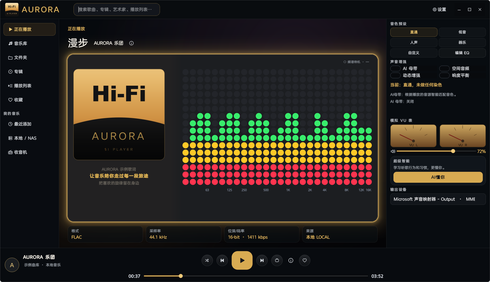

## 音乐库

**入口：** 左侧「音乐库」。查看全部歌曲的标题、艺术家、专辑、格式、采样率和时长。可添加单个文件、导入文件夹或重新扫描；双击歌曲播放，右键可加入队列或列表、查看资料以及执行曲库操作。顶部搜索框用于查找音乐。

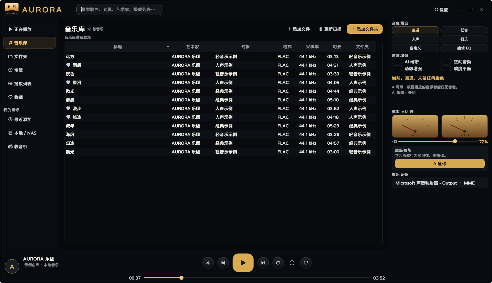

## 文件夹

**入口：** 左侧「文件夹」。左侧目录树保留你的音乐目录层级，右侧列出所选范围内的歌曲。支持添加、移除扫描目录和重新扫描；从此页也能打开 CUE 整轨分轨。不同目录里的同一首歌曲在各自目录中仍可查看。

移除已添加目录时，会同时移除该目录的歌曲记录，专辑、艺术家、收藏和播放列表自动更新，磁盘上的音乐文件保留。仍被其他已添加目录覆盖的歌曲继续保留。

如果旧版本已经移除了所有目录，但专辑里仍有歌曲，回到「文件夹」点击 **「清理残留记录」**。确认后先备份曲库，再清理全部曲库歌曲记录，包括单独添加的文件；原始文件、设置和授权保留。备份位置会在完成窗口显示。

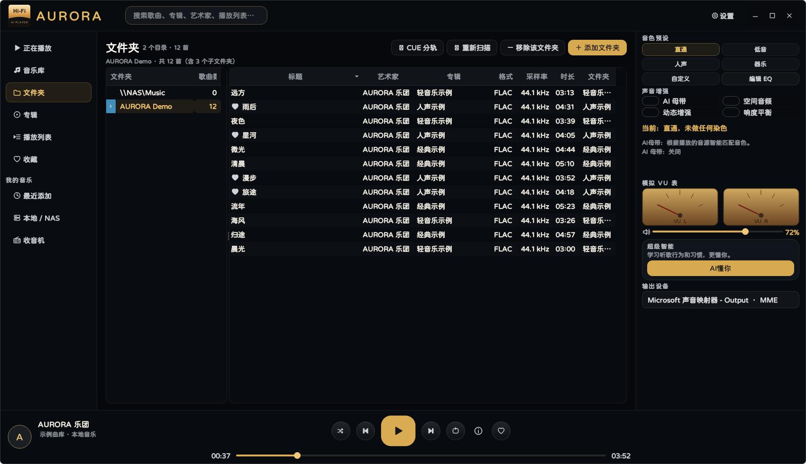

**CD 曲序与当前歌曲：** 进入目录或专辑时，默认按碟号、音轨号和 CUE 曲序排列；没有曲号的文件按文件名中的数字自然排序。点击列标题仍可自行排序，再进入目录会按保存的顺序或 CD 默认顺序显示。缺少曲号且文件名也没有曲序时，播放器按文件名排序，无法确定原版唱片顺序。

在文件夹或专辑页面开启「手动排序」，拖动歌曲后自动保存该目录或专辑的顺序；重开播放器仍保留。可点击「恢复 CD 曲序」还原原始顺序。拖动模式下单击选中，双击播放。正在播放的歌曲带金色播放标志，暂停时改为暂停标志；拖动更新队列而不重播当前歌曲。

**播放位置：** 当前歌曲在表格中高亮，重新进入所在目录会自动滚动到这首歌。目录上方显示相邻歌曲，播放条右侧按歌词样式竖排滚动显示上一首、当前歌曲和下一首，只有当前歌名黄色；没有相邻歌曲时不显示占位，点击相邻歌名直接跳转，点击当前歌名定位所在目录。随机或智能播放可能改变下一次自动选曲；这里显示的是当前队列中可直接点击的相邻歌曲。

## 专辑

**入口：** 左侧「专辑」，或曲目表格中的专辑名称。左边选择专辑，右边查看该专辑的歌曲和音质信息。专辑归类依赖文件标签和已入库资料，双击曲目即可开始播放。

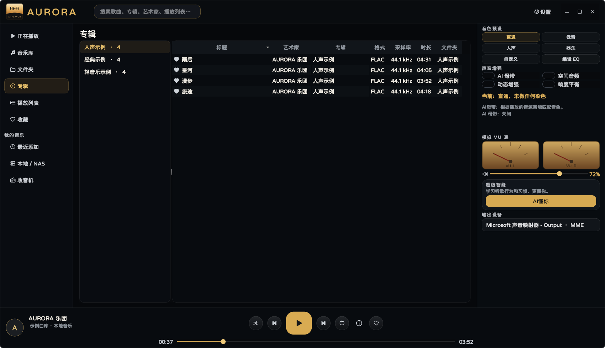

## 播放列表

**入口：** 左侧「播放列表」。通过「新建播放列表」建立普通列表，再从曲目右键菜单添加歌曲；普通列表可拖动调整曲目顺序并保存。全功能版还可选择「按文件夹推荐」类型，限定推荐的音乐目录，并用「重新推荐」更新结果。

下图为普通播放列表的曲目区，展示已选列表中的歌曲。

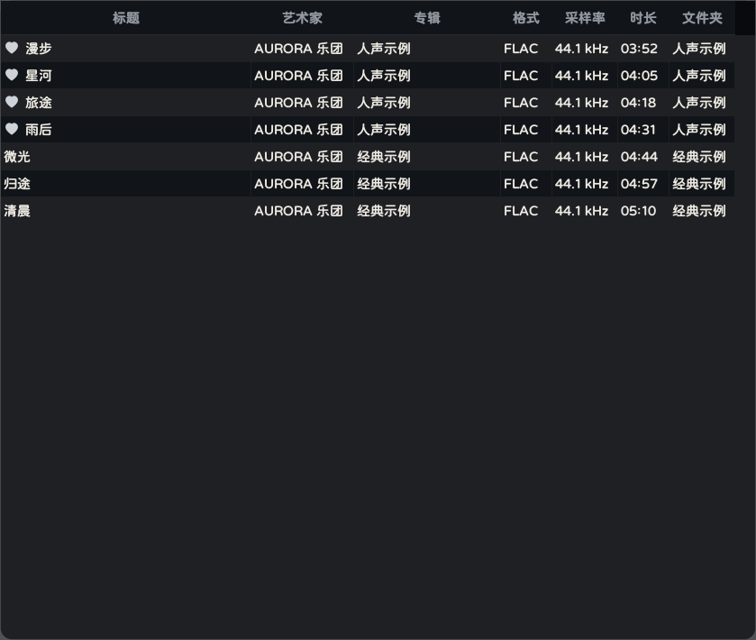

## 听歌风格

**入口：** 左侧「听歌风格」。圆角栏目分为「听歌偏好」和「喜欢的歌」，默认各显示三首预览；点击「全部歌曲」在本页展开，返回后恢复预览及原来的滚动位置。

听歌偏好收录完整听过三次及以上的歌曲，按总播放次数排序，并显示实际次数；喜欢的歌按最近点心时间排序，重新点心后置顶。「听我喜欢」从喜欢的歌曲范围开始播放。风格介绍和学习摘要沿用同一份记录，种子资格与推荐算法保持不变。

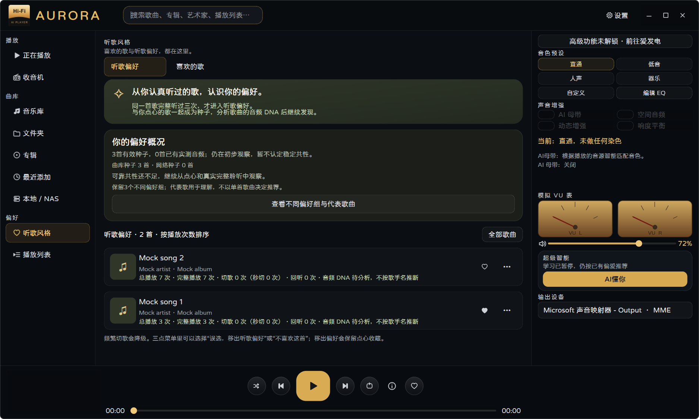

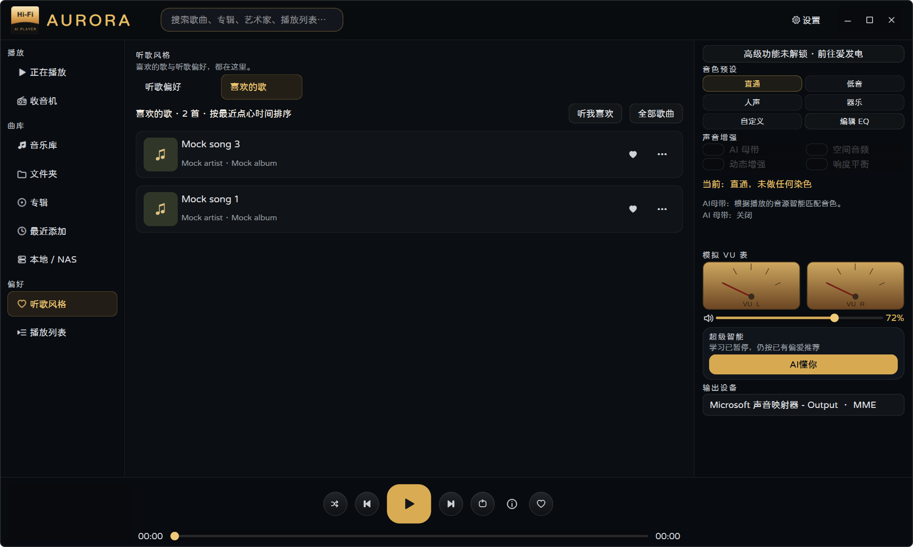

## 最近添加

**入口：** 左侧「最近添加」。按入库时间展示音乐，快速找到刚导入的歌曲。这里沿用音乐库的播放、收藏和曲目菜单。

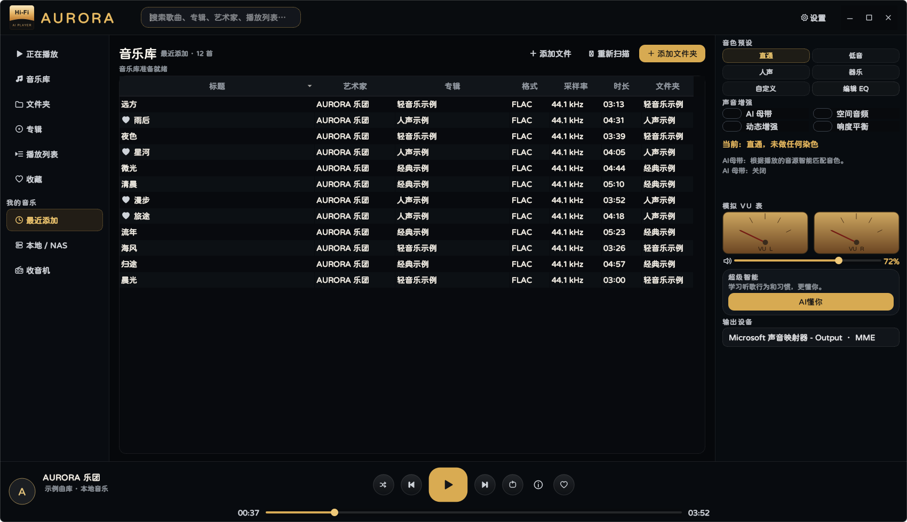

## 本地 / NAS

**入口：** 左侧「本地 / NAS」。选择本地文件夹，或填写 Windows 已能访问的 NAS / SMB 路径，然后连接并扫描。已保存目录可再次扫描或移除。NAS 访问权限需先在 Windows 中配置，本页不会替代 NAS 的账户与共享设置。

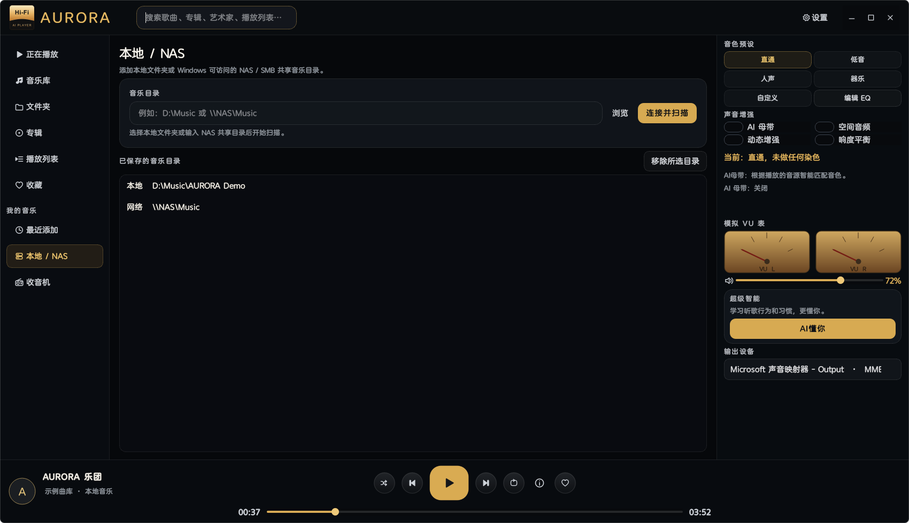

## 歌手资料

**入口：** 播放页的歌手区域、播放条头像或歌曲的歌手入口。查看可获取的公开头像与简介，并集中浏览本地曲库里属于该歌手的歌曲。网络资料缺失时，仍保留本地曲目列表；不会为了填满简介而虚构歌手资料。

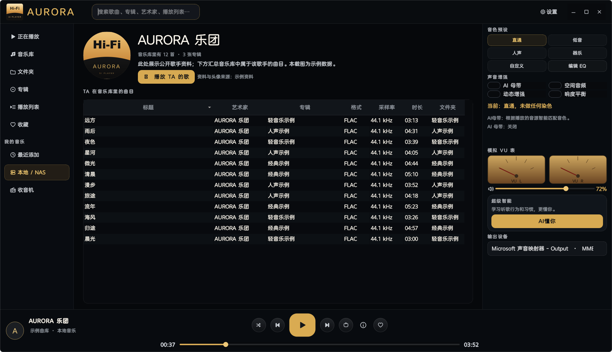

## AI 学习与偏爱

**入口：** 「设置 → AI 学习与偏爱」。开关行为学习，先阅读风格介绍和学习摘要，再查看支持判断的歌曲、曲风组及音频分析依据。歌曲预览和摘要与「听歌风格」使用同一份记录；查看全部歌曲、展开风格组、管理不喜欢记录及重置确认均在当前页内完成。

这次调整展示和内容组织，保留已有种子资格、行为权重及推荐算法。一次快速切歌不直接等于长期不喜欢；证据不足时明确提示继续积累，用户可以复核与纠正记录。

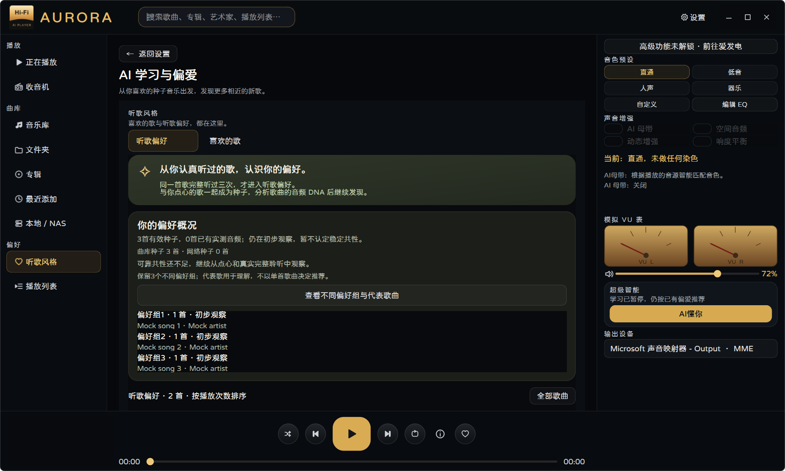

## AI 懂我与学习结果

**推荐入口：** 主窗口右侧「AI懂你」，根据已有学习记录从曲库中推荐歌曲。

**学习结果：** 「设置 → AI 学习与偏爱」直接显示风格介绍、学习摘要、代表歌曲及判断依据。积累不足时显示当前状态，随着有效听歌记录增加更新结果。

## 设置

**入口：** 右上角「设置」。可即时切换界面语言，开关启动扫描、缺失歌词与封面的在线匹配，以及歌词旁置保存。页面可滚动，进一步查看曲库维护和支持格式；「为爱发电」为独立页签。

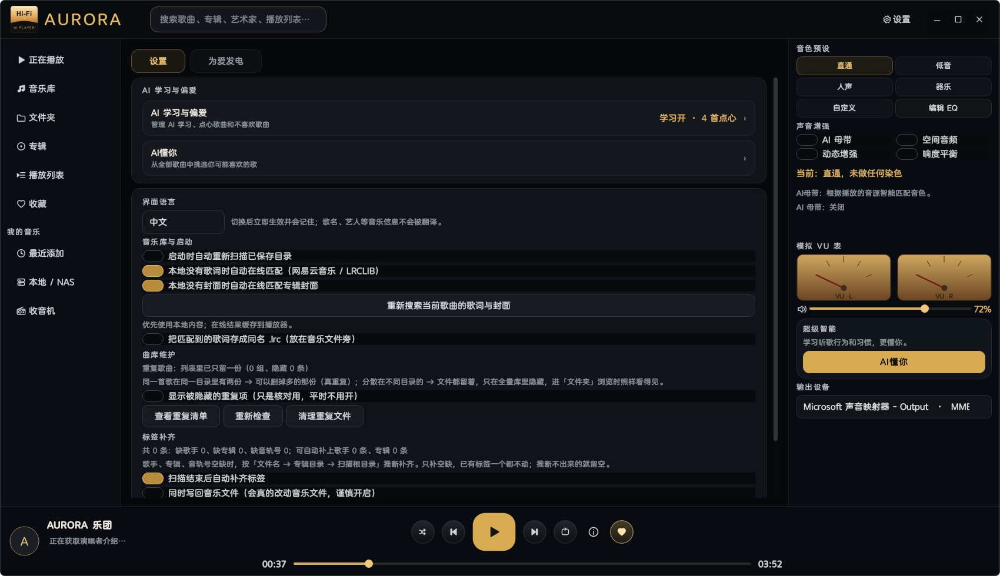

## 曲库维护与标签补齐

**入口：** 设置页向下滚动到曲库维护区。点击「查看待补项」，在本页核对歌曲、缺失字段、可从本地补齐的内容和仍需目录核验的内容。预览只读，不会改标签。

「立即补齐」先读取音乐文件已有标签，再使用明确的文件名、专辑目录等线索；需要在线核验时，按歌曲、演唱者、版本及长度判断。只补空缺，已有标签保留，不能确认的字段留待确认。结果分别显示成功、文件写回失败和 CUE 跳过数量。

「同时写回音乐文件」需单独开启，开启后会修改可写入的单曲文件。CUE 共用整轨音频不按分轨标签写回。重复检查和标签补齐各自显示进度及结果，可先查看清单再决定操作。

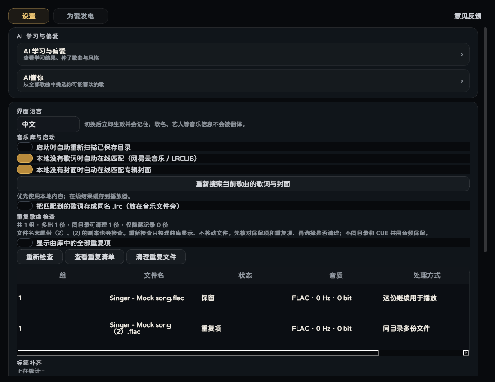

## 为爱发电

**入口：** 「设置 → 为爱发电」。可打开 ¥10 / 30 天或 ¥98 买断商品，粘贴爱发电私信收到的激活码，或重新核验授权。30 天付费授权从首次自动核验付款成功起算。全功能首次免费试用 7 天，到期后继续使用基本版；需要全功能可付费解锁。页面显示当前试用 / 授权状态、到期时间及软件版权信息；两个付费方案开放相同功能。

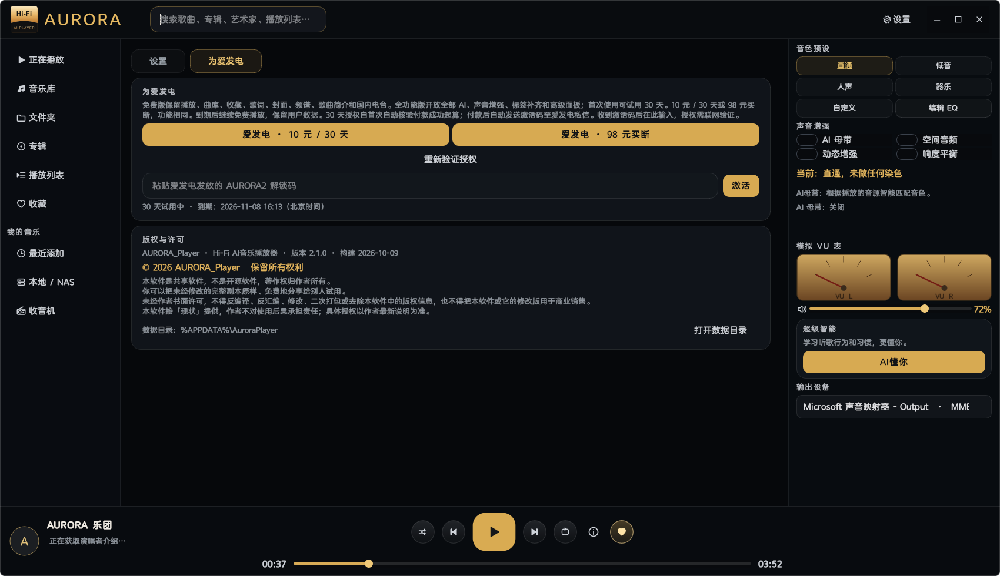

## 播放面板设置

**入口：** 正在播放的面板「设置」入口，翻到面板背面。全功能版可调整透光、频谱配色、氛围灯颜色及动态，以及玻璃 / 金属面板材质。设置实时应用；返回面板正面继续查看封面与频谱。

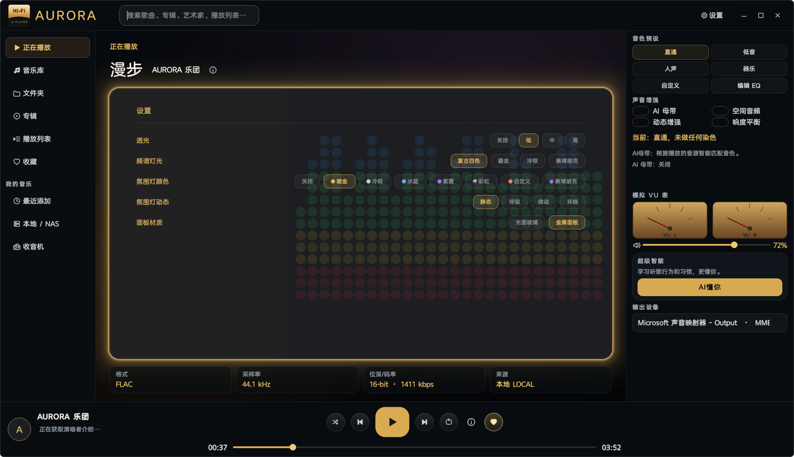

## 声音控制与九段 EQ

**入口：** 主窗口右侧固定声音面板，「编辑 EQ」打开九段均衡器。可选择直通、低音、人声、器乐或自定义预设，调整音量及输出设备。九段 EQ 支持各频段 −12 至 +12 dB。全功能版可启用 AI 母带、空间音频、动态增强和响度平衡。AI 母带根据音源匹配音色、动态与响度处理，空间音频由你手动选择；当前处理状态与音源分析显示在面板内。也可关闭 AI 母带，切回直通或自行调整。

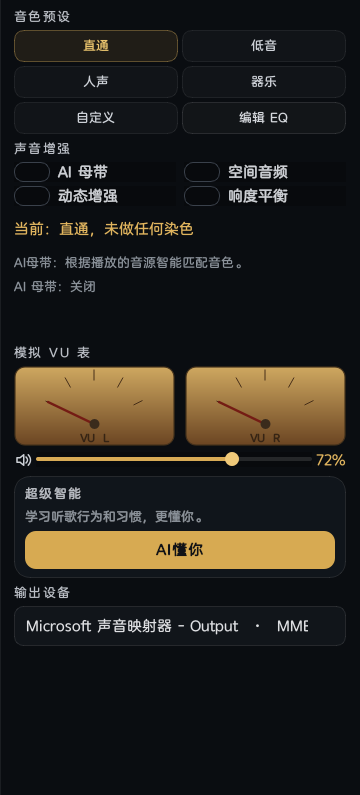

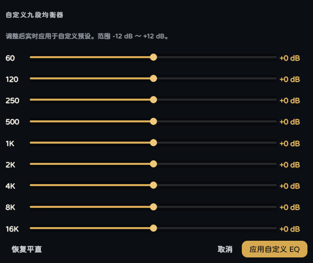

## 新建播放列表

**入口：** 「播放列表 → 新建播放列表」。填写名称，选择普通手工列表或全功能版的「按文件夹 AI」类型。智能列表需选择目录范围，后续从这个范围内动态推荐；普通列表由你添加歌曲并排序。

## CUE 整轨分轨

**入口：** 文件夹页的 CUE 分轨按钮。选择 `.cue` 后查看曲名、表演者、起点和时长，指定输出目录并确认分轨。可勾选完成后将生成的单曲加入音乐库；解析和分轨结果在窗口内显示。

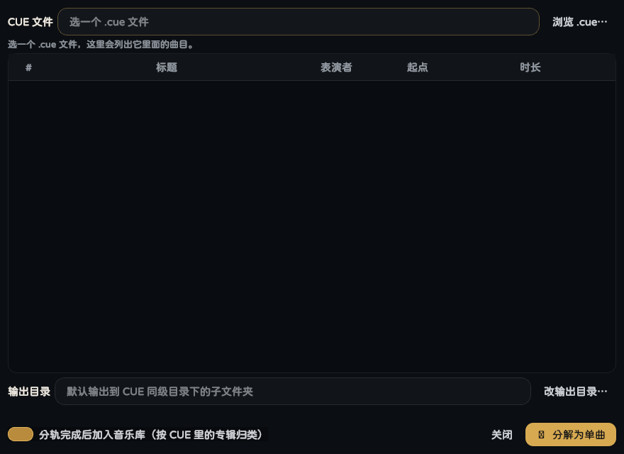

## 收音机

**入口：** 左侧「收音机」。选择国内地区或收藏，按电台名称搜索并收听；可收藏常听电台，暂停或停止收听。此窗口独立于曲库页，电台目录及直播流需要联网，可用性取决于对应电台。

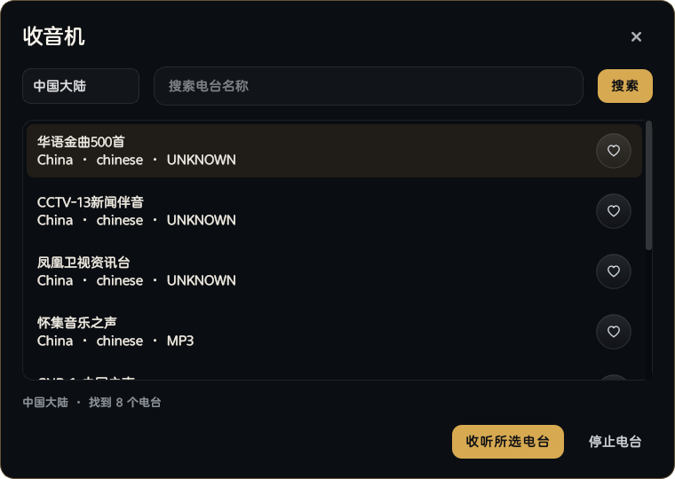

## 歌曲简介

**入口：** 歌曲信息旁的圆圈 i、底部播放条的歌曲简介按钮，或曲目右键菜单中的「歌曲简介」。独立窗口依次展示歌曲资料、歌手、专辑、创作信息和资料来源。有可靠数据才显示；歌曲首次发行与当前专辑版本发行日期分别处理。查询优先本地标签，再使用 MusicBrainz、Wikidata / Wikipedia 等公开来源，不调用 AI 生成资料。打开、关闭和重新查询均不改变播放进度或队列。

本例仅有本地标签，因而只展示能确认的字段。

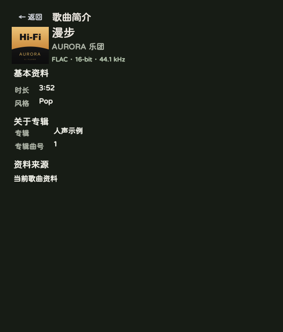

## 重复歌曲清单

**入口：** 「设置 → 查看重复清单」。本页表格按组显示歌曲、保留或合并状态、音质、文件路径和建议处理方式。检查本身保留音乐文件，跨目录副本仍可在各自目录里查看。

文件名中的「（2）」或「(2)」编号副本也参与检测；同时核对歌名、歌手、时长及版本。现场版、不同歌手、明显不同时长和真实带编号的曲名不会仅因名称相近被合并。CUE 共用音频及独立分轨不会作为普通副本清理。

查看结果后再选择清理方式，文件删除仍需要明确确认。

## 点心歌曲

**入口：** 「听歌风格 → 喜欢的歌」。预览或展开全部歌曲，最近点心和重新点心的歌曲排在最上面。点击歌曲播放，使用曲目菜单调整喜欢状态；「听我喜欢」播放喜欢的歌曲范围。

## 不喜欢的歌曲

**入口：** 「设置 → AI 学习与偏爱 → 学习管理」。在本页展开不喜欢的歌曲，复核判断并恢复为普通状态；清空记录和重置学习采用页内确认。恢复歌曲状态保留原音乐文件。

## 意见反馈

**入口：**「设置 → 意见反馈」。填写问题或建议，点击「发送反馈」后，默认邮件程序会打开已填好收件人、主题和内容的草稿，请在邮件程序中确认发送。最多 500 字；未配置默认邮件程序时，内容保留在窗口中，配置后可重试。

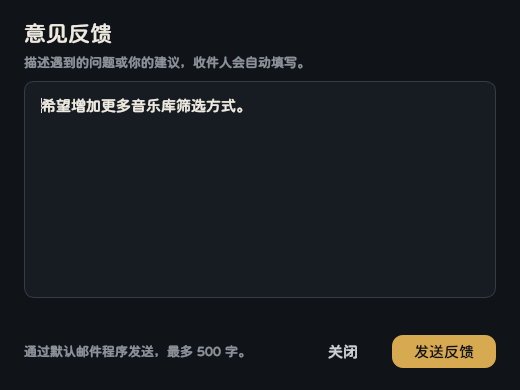

## 字体许可

**入口：**「设置 → 为爱发电 → 字体许可」。当前界面使用寒蝉全圆体 v3.200 原版常规与粗体，字体采用 SIL OFL 1.1，可免费商用及随软件分发。原始版权及许可随程序保留；字体许可与播放器自身的共享软件许可分别适用。

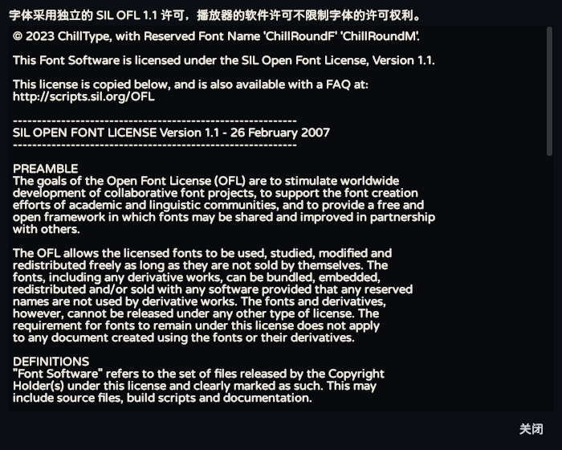
